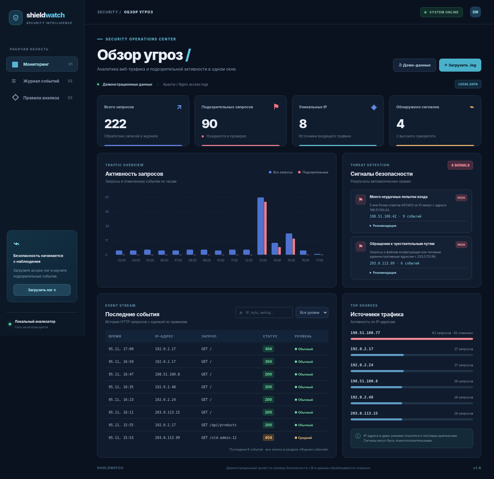
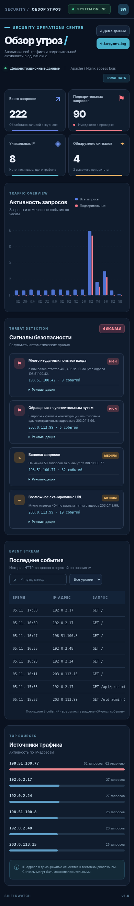

# ShieldWatch — анализатор веб-логов

Учебный проект по информационной безопасности: импорт и анализ стандартных access-логов Apache/Nginx, поиск аномалий, интерактивная панель с фильтрацией, статистикой и рекомендациями.

## Запуск

```bash
cd shieldwatch
python -m venv .venv
# Windows: .venv\Scripts\activate
# macOS/Linux: source .venv/bin/activate
pip install -r requirements.txt
uvicorn app:app --reload --host 127.0.0.1 --port 8001
```

Откройте http://127.0.0.1:8001 . Документация API: http://127.0.0.1:8001/docs .

При первом старте SQLite создаёт **синтетические** записи с адресами из диапазонов для документации (RFC 5737). Можно загрузить свой файл `.log` / `.txt` (не более 2 МБ и 10 000 строк) или восстановить демонстрационные данные.

## Что обнаруживает

| Правило | Условие | Уровень |
| --- | --- | --- |
| auth | 5+ ответов 401/403 за 10 минут от одного IP | Высокий |
| probe | Запросы к `/.env`, `/.git/`, `/wp-login.php` и другим типовым путям | Высокий |
| scan | 8+ ответов 404 для 6+ разных путей от одного IP | Средний |
| burst | 50+ запросов за 5 минут от одного IP | Средний |

Это простые эвристики. **Сигнал не является доказательством атаки**: возможны ложные срабатывания, а некоторые атаки вовсе не будут замечены. Нет анализа содержимого запросов, геолокации или внешних IP-репутаций.

## Формат логов

Поддерживается стандартный `combined` и базовый `common` формат Nginx/Apache, например:

```text
198.51.100.42 - - [05/Nov/2026:11:03:15 +0000] "GET /.env HTTP/1.1" 404 124 "-" "DemoTest"
```

После импорта прежний набор записей **заменяется**, что показано в интерфейсе. Загруженные записи хранятся локально в `shieldwatch.db`; не загружайте чужие приватные логи и не публикуйте базу данных.

## Тесты

```bash
pip install pytest httpx
pytest -q
```

**Важно:** это не SIEM и не IDS, а демонстрационный анализатор. API импорта и сброса не защищены авторизацией; по умолчанию запускайте только на `127.0.0.1`. Для публичного размещения нужны аутентификация, права доступа, лимиты, журнал действий и политика обработки персональных данных.

Технологии: Python, FastAPI, SQLite, регулярные выражения, HTML, CSS, JavaScript.
## Скриншоты

### Панель мониторинга


### Мобильная версия

